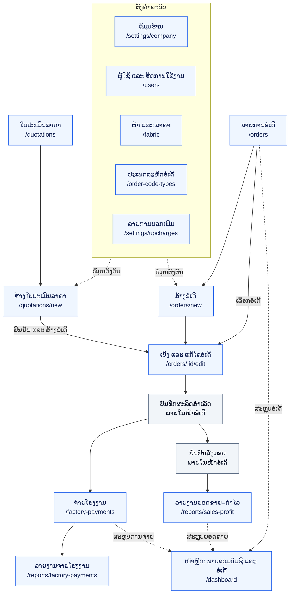
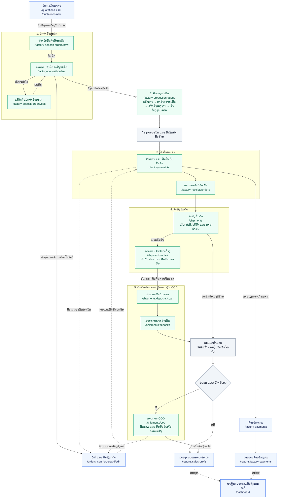

# ແຜນຜັງການເຮັດວຽກລະບົບຈັດການຮ້ານ

ແບບສຳລັບທົບທວນຂອບເຂດກັບລູກຄ້າ ໂດຍອີງໃສ່ແພັກເກັດເລີ່ມຕົ້ນໃນ `customer-erp-web` ແລະ ຂັ້ນຕອນຜະລິດ–ຈັດສົ່ງໃນ `bgsport-panel-web`.

ລູກຄ້າຄົນທີ 1 ໃຊ້ 6 ໝວດຂອງແພັກເກັດເລີ່ມຕົ້ນ. ລູກຄ້າຄົນທີ 2 ໃຊ້ແພັກເກັດເດີມ ແລະ ເພີ່ມອີກ 5 ໝວດ.

ສີຟ້າ = ໜ້າໃນແພັກເກັດເລີ່ມຕົ້ນ; ສີຂຽວ = ໜ້າທີ່ເພີ່ມ; ສີເທົາ = ຂັ້ນຕອນ ຫຼື ເງື່ອນໄຂພາຍໃນໜ້າ. ລູກສອນເສັ້ນທຶບ = ລຳດັບວຽກ; ລູກສອນເສັ້ນປະ = ຂໍ້ມູນທີ່ເຊື່ອມໂຍງ. ກ່ອງທີ່ບໍ່ມີທີ່ຢູ່ໜ້າແມ່ນຂັ້ນຕອນວຽກ.

## 1. ແພັກເກັດເລີ່ມຕົ້ນ — 6 ໝວດ

- ສາມາດສ້າງອໍເດີໂດຍກົງ ຫຼື ສ້າງຈາກໃບປະເມີນລາຄາ.
- ໜ້າແກ້ໄຂອໍເດີໃຊ້ບັນທຶກຂໍ້ມູນລູກຄ້າ, ສິນຄ້າ, ເງິນມັດຈຳ, ການຮັບຊຳລະ, ຕົ້ນທຶນ ແລະ ການສົ່ງມອບ.
- ການຈ່າຍໂຮງງານ ແລະ ການສົ່ງມອບເປັນສອງສາຍວຽກ. ລູກສອນບໍ່ໄດ້ກຳນົດໃຫ້ຈ່າຍໂຮງງານຄົບກ່ອນຈຶ່ງຈັດສົ່ງໄດ້.
- ໜ້າຫຼັກສະແດງພາບລວມຈາກຂໍ້ມູນທີ່ບັນທຶກໃນລະບົບ.

## 2. ສ່ວນເພີ່ມສຳລັບລູກຄ້າຄົນທີ 2 — 5 ໝວດ

## 3. ລາຍລະອຽດແຕ່ລະໝວດທີ່ເພີ່ມ

| ໝວດ | ໜ້າ | ໜ້າທີ່ ແລະ ຂໍ້ມູນທີ່ສົ່ງຕໍ່ |
| --- | --- | --- |
| ມັດຈຳສັ່ງຜະລິດ | `/factory-deposit-orders`, `/new`, `/edit` | ສ້າງ ແລະ ແກ້ໄຂໃບມັດຈຳ, ແນບຫຼັກຖານ, ສົ່ງເຂົ້າຄິວ, ອະນຸມັດ ແລະ ບັນທຶກເປັນອໍເດີ. |
| ຄິວວາງຜະລິດ | `/factory-production-queue` | ຈັດລຳດັບຄິວ, ມອບໝາຍຜູ້ຮັບຜິດຊອບ ແລະ ຕິດຕາມຂັ້ນຕອນຈົນສົ່ງໂຮງງານ. |
| ຮັບສິນຄ້າເຂົ້າ | `/factory-receipts`, `/factory-receipts/orders` | ສະແກນລະຫັດບິນໂຮງງານ, ຢືນຢັນຮັບເຂົ້າ ແລະ ສະແດງອໍເດີທີ່ຮັບແລ້ວເພື່ອແຈ້ງລູກຄ້າ ແລະ ກຽມຈັດສົ່ງ. |
| ຈັດສົ່ງສິນຄ້າ | `/shipments`, `/shipments/notes` | ບັນທຶກຜູ້ຮັບ, ຂົນສົ່ງ, ການຊຳລະ ແລະ ຍອດ COD; ຈັດການ ແລະ ພິມໃບຝາກເຄື່ອງ. |
| ຢືນຢັນຝາກ ແລະ COD | `/shipments/deposits/scan`, `/shipments/deposits`, `/shipments/cod` | ສະແກນໃບຝາກ, ບັນທຶກຜູ້ຝາກ ແລະ ເວລາ, ກວດລາຍການຝາກສຳເລັດ ແລະ ຕິດຕາມເງິນ COD ຈົນຮັບເງິນ. |

## 4. ຂໍ້ກຳນົດສຳລັບອອກແບບລະບົບລູກຄ້າຄົນທີ 2

1. **ໃຊ້ຂໍ້ມູນອໍເດີຮ່ວມກັນ:** ໃບປະເມີນລາຄາ → ໃບມັດຈຳ → ອໍເດີ → ຮັບສິນຄ້າ → ຈັດສົ່ງ. ຂໍ້ມູນທີ່ມີແລ້ວຄວນນຳມາໃຊ້ຕໍ່ ແລະ ເຊື່ອມກັນດ້ວຍລະຫັດອ້າງອີງ.
2. **ຄິວຜະລິດ ແລະ ການສ້າງອໍເດີ:** ໂຄດເດີມໃຫ້ໃບມັດຈຳທີ່ສົ່ງແລ້ວເຂົ້າຄິວໄດ້; ການບັນທຶກເປັນອໍເດີຕ້ອງຜ່ານການອະນຸມັດ. ຈຶ່ງແຍກເປັນສອງສາຍໃນແຜນຜັງ ແລະ ຕ້ອງມີອໍເດີກ່ອນກວດຮັບສິນຄ້າ.
3. **ຂອບເຂດໜ້າຄິວ:** ແຜນຜັງນີ້ສະແດງ 4 ສະຖານະພາຍໃນໝວດ `/factory-production-queue`. ໜ້າລາຍງານຄິວ ແລະ ໜ້າຍ່ອຍອື່ນຂອງລະບົບເດີມຍັງບໍ່ໄດ້ລວມເຂົ້າໃນແພັກເກັດນີ້.
4. **ອະນຸມັດສົ່ງມອບ:** ໂຄດເດີມໃຊ້ `/shipments/approvals` ຫຼັງຢືນຢັນຝາກ. ເນື່ອງຈາກໜ້ານີ້ບໍ່ຢູ່ໃນລາຍການທີ່ລູກຄ້າເລືອກ, ແບບທີ່ສະເໜີແມ່ນຮວມປຸ່ມອະນຸມັດໄວ້ໃນ `/shipments` ໂດຍໃຫ້ຜູ້ມີສິດເປັນຜູ້ຢືນຢັນ. ນີ້ແມ່ນຂໍ້ສະເໜີການອອກແບບ; ຍັງບໍ່ໄດ້ປັບໂຄດຈິງ.
5. **ສະຖານະຝາກ ແລະ ສະຖານະເງິນ:** ການຢືນຢັນຝາກສຳເລັດບໍ່ແມ່ນການຢືນຢັນຮັບເງິນ COD. ອໍເດີທີ່ມີ COD ຄ້າງຮັບຕ້ອງຕິດຕາມຕໍ່ໃນ `/shipments/cod`; ການຮັບຮູ້ກຳໄລໃຊ້ເງື່ອນໄຂສົ່ງມອບສຳເລັດ ແລະ ຮັບເງິນ COD ຄົບ.
6. **ຊື່ໜ້າແກ້ໄຂ:** `/orders/edit` ໃນລາຍການໝາຍເຖິງໜ້າແກ້ໄຂອໍເດີ; ໂຄດຈິງໃຊ້ `/orders/:id/edit`. ໜ້າ `/factory-deposit-orders/edit` ໃນແຜນຜັງແມ່ນຊື່ຕາມຂອບເຂດທີ່ຂໍ; ໂຄດເດີມໃຊ້ `/factory-deposit-orders/new?id=...` ເພື່ອແກ້ໄຂ.

## 5. ແຫຼ່ງອ້າງອີງໃນໂຄດ

- ເມນູແພັກເກັດເລີ່ມຕົ້ນ: `../customer-erp-web/lib/app-navigation.ts`
- ສ້າງອໍເດີຈາກໃບປະເມີນລາຄາ: `../customer-erp-web/app/(app)/quotations/new/page.tsx`
- ບັນທຶກຜະລິດ ແລະ ສົ່ງມອບໃນແພັກເກັດເລີ່ມຕົ້ນ: `../customer-erp-web/app/(app)/orders/[id]/edit/page.tsx`
- ອະນຸມັດໃບມັດຈຳ ແລະ ສ້າງອໍເດີ: `app/(app)/factory-deposit-orders/page.tsx`
- ສະຖານະຄິວຜະລິດ: `lib/factory-production-queue.ts`
- ການເຂົ້າຄິວ: `supabase/migrations/20260624_create_factory_production_queue_entries.sql`
- ຮັບສິນຄ້າ: `app/(app)/factory-receipts/page.tsx`
- ສ້າງລາຍການຈັດສົ່ງ ແລະ ໃບຝາກ: `app/(app)/shipments/page.tsx`
- ຢືນຢັນຝາກ: `app/(app)/shipments/deposits/scan/page.tsx`
- ຢືນຢັນຮັບເງິນ COD: `app/(app)/shipments/cod/page.tsx`
- ລາຍງານກຳໄລ: `app/(app)/reports/sales-profit/page.tsx`
