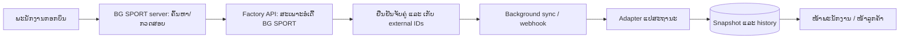

# ແຜນເຊື່ອມສະຖານະໂຮງງານ LifeFootball

ກວດສອບ: 20 ຕຸລາ 2026. ສະຖານະ: ຜົນກວດສອບ ແລະ ແບບອອກແບບ; ຍັງບໍ່ໄດ້ປ່ຽນໂຄດທີ່ໃຊ້ງານ ຫຼື ເຊື່ອມ production.

## 1. ຂໍ້ສະເໜີ

ໃຊ້ວິທີກອກລະຫັດໂຮງງານເພື່ອຈັບຄູ່ອໍເດີ້ ແບບ track ເກົ່າໄດ້. ລະບົບເຮົາມີພື້ນຖານນີ້ແລ້ວ. ເພີ່ມຂັ້ນຕອນຄົ້ນຫາບິນ → ກວດລາຍລະອຽດ → ຢືນຢັນຈັບຄູ່ → ອັບເດດອັດຕະໂນມັດ.

ຂໍ API ສຳລັບ server ຈາກໂຮງງານທີ່ອ່ານໄດ້ສະເພາະອໍເດີ້ BG SPORT. API ທີ່ໜ້າເວັບໃຊ້ຢູ່ຢືນຢັນວ່າມີຂໍ້ມູນພໍສຳລັບພັດທະນາຕົວເຊື່ອມ; ແຕ່ຍັງຕ້ອງໃຫ້ໂຮງງານຢືນຢັນວິທີເຂົ້າໃຊ້, ຄວາມໝາຍຂອງຂໍ້ມູນ ແລະ ສັນຍາ API ທີ່ຮອງຮັບການເຊື່ອມພາຍນອກ.

## 2. ຜົນກວດສອບເວັບຈິງ

ເຂົ້າບັນຊີທີ່ຜູ້ໃຊ້ໃຫ້ ແລະ ກວດ GET requests ຂອງ [ໜ້າຕິດຕາມການຜະລິດ](https://bgsport.lifefootball.la/agent/production?status=in_progress). ບໍ່ໄດ້ແກ້ໄຂອໍເດີ້, ການຜະລິດ ຫຼື ການສົ່ງ. ບໍ່ເກັບລະຫັດຜ່ານ, cookies, tokens ຫຼື ຂໍ້ມູນຕິດຕໍ່ລູກຄ້າໄວ້ໃນເອກະສານ.

| API ທີ່ກວດພົບ | ຜົນທີ່ຢືນຢັນ |
| --- | --- |
| `GET /api/agent-portal/production/queue?status=in_progress&limit=20&offset=0` | HTTP 200 ຫຼັງ login; ສົ່ງ `items` ແລະ `meta` ທີ່ມີ `limit`, `offset`, `total` |
| `GET /api/agent-portal/production/queue?status=in_progress&q={bill_code}&limit=20&offset=0` | ຄົ້ນຫາດ້ວຍບິນທີ່ສະແດງໃນເວັບໄດ້; ຕົວຢ່າງທີ່ທົດລອງຄືນມາ 1 ລາຍການ. `q` ເປັນການຄົ້ນຫາຫຼາຍ field, ຍັງບໍ່ແມ່ນສັນຍາ exact lookup |
| `GET /api/agent-portal/production/stages` | HTTP 200; ສົ່ງ `stages`, `statusCounts`, `stageCounts`; ຂັ້ນຕອນມີ `id`, `code`, `name`, `sortOrder` |
| `GET /api/agent-portal/orders/{customerOrderId}` | HTTP 200 ສຳລັບອໍເດີ້ທີ່ບັນຊີນີ້ເຂົ້າເບິ່ງໄດ້; ມີ `order`, `production`, `statusView`, `lastMileDelivery` ແລະ ຂໍ້ມູນອື່ນ |
| `GET /api/agent-portal/production/queue?status=completed&limit=2&offset=0` | ຕົວຢ່າງທີ່ກວດໄດ້ມີ item `status: in_stock` ແລະ ຂັ້ນຕອນທັງໝົດ `done` |
| ຮ້ອງຂໍ queue ໂດຍບໍ່ login | HTTP 401; ບໍ່ແມ່ນ API ສາທາລະນະ |

ສິ່ງທີ່ຍັງບໍ່ໄດ້ຢືນຢັນ: ການຮອງຮັບ API token/OAuth, webhook, exact lookup ທຸກສະຖານະ, bulk lookup, `updated_since`, ຂໍ້ຈຳກັດ rate limit, ສັນຍາ versioning ແລະ ວ່າບິນໜຶ່ງມີຫຼາຍ PO ໄດ້ຫຼືບໍ່. ບໍ່ຄວນຕີຄວາມວ່າ API ພາຍໃນເຫຼົ່ານີ້ເປັນ public integration API ແລ້ວ.

### ລະຫັດທີ່ຕ້ອງແຍກ

| Field ໃນ queue | ຄວາມໝາຍຈາກສິ່ງທີ່ກວດພົບ | ການໃຊ້ໃນແຜນເຮົາ |
| --- | --- | --- |
| `customerOrderCode` | ບິນທີ່ສະແດງໃນຖັນບິນ, ຮູບແບບ `26-xxxxxx` | ໃຫ້ພະນັກງານກອກ/ຄົ້ນຫາ; ເກັບໃນ `factory_bill_code` |
| `customerOrderId` | ID ທີ່ລິ້ງບິນໃຊ້ເປີດໜ້າລາຍລະອຽດອໍເດີ້ | ເກັບເປັນ external order ID ຫຼັງຈັບຄູ່ |
| `code` | ລະຫັດ PO, ຮູບແບບ `PO-...` | ເກັບເປັນ production order code |
| `id` | ID ຂອງລາຍການຄິວ/PO | ເກັບເປັນ production order ID; ໃຫ້ໂຮງງານຢືນຢັນຄວາມຄົງທີ່ຂອງ ID |

ຫ້າມຈັບຄູ່ຈາກຊື່ລູກຄ້າ ຫຼື ເລືອກຜົນຄົ້ນຫາທຳອິດໂດຍອັດຕະໂນມັດ. ຕ້ອງກວດບິນກົງກັນເຕັມ ແລະ ສິດຂອງຮ້ານ; ຖ້າມີຫຼາຍຜົນໃຫ້ພະນັກງານກວດເລືອກ.

### ຂັ້ນຕອນຜະລິດ

ໃນຕົວຢ່າງອໍເດີ້ເສື້ອ ພົບ 7 ຂັ້ນຕອນ:

| Stage code | ຊື່ໃນລະບົບໂຮງງານ |
| --- | --- |
| `ACCOUNT` | ອອກບິນຜະລິດ |
| `PATTERN` | ກຳລັງວາງແບບ |
| `PRINTING` | ກຳລັງພີມ |
| `ROLL` | ກຳລັງລີດລົງຜ້າ |
| `CUTTING` | ກຳລັງຕັດ |
| `SEW` | ກຳລັງຍິບ |
| `QC` | ກຳລັງກວດຄຸນນະພາບ |

queue ສົ່ງ `stages[].state` ເປັນ `done`, `active`, `pending` ໃນຕົວຢ່າງທີ່ກວດ. ລາຍລະອຽດອໍເດີ້ໃຊ້ field ອີກຊຸດ: `stageName`, `stageCode`, `sortOrder`, `status`, `current`, `assignedQuantity`, `completedQuantity`, `transferredQuantity`, `completedAt`, `activeReworks`, `customerDefects`. ຕ້ອງຂໍ enum ແລະ ຄວາມໝາຍຂອງ field ເຫຼົ່ານີ້ຈາກໂຮງງານ.

global stage catalog ຍັງມີຂັ້ນຕອນເກີບ. ຈຶ່ງຕ້ອງສ້າງ timeline ຈາກ stages ຂອງແຕ່ລະອໍເດີ້; ບໍ່ບັງຄັບທຸກອໍເດີ້ໃຫ້ມີ 7 ຂັ້ນ ຫຼື ໃຊ້ global index ຢ່າງດຽວ.

`completed` ໃນ filter ບໍ່ແມ່ນ raw status ດຽວ. ຕົວຢ່າງ `in_stock` ຍັງມີ `currentActiveStageName` ເປັນ QC ແຕ່ທຸກ stage ເປັນ `done`. ການຄິດສະຖານະຕ້ອງເບິ່ງ lifecycle ແລະ stage states ປະກອບກັນ.

## 3. ພື້ນຖານທີ່ມີໃນ BG SPORT Panel

| ສ່ວນທີ່ມີ | ໄຟລ໌ |
| --- | --- |
| ຊ່ອງກອກ `factory_bill_code` ແລະ ປຸ່ມ sync ສຳລັບບິນທີ່ບັນທຶກແລ້ວ | `app/(app)/orders/[id]/edit/page.tsx` |
| ດຶງ API ເກົ່າ `GET https://www.tracklifefootball.com/api/orders/{factory_bill_code}` ແລະ ແປ response `{ok, order}` | `lib/factory-production.ts` |
| sync ລາຍອໍເດີ້ ແລະ ຫຼາຍອໍເດີ້ | `app/api/orders/[id]/factory-production/route.ts`, `app/api/orders/factory-production/sync/route.ts` |
| fields ສະຖານະ, ເວລາ, payload, error | `supabase/migrations/20260409_add_factory_tracking_sync_fields.sql` |
| ສະແດງສະຖານະໃຫ້ລູກຄ້າ | `lib/public-order-tracking.ts`, `app/api/public/order-tracking/route.ts` |
| image proxy ທີ່ຍັງອີງ host ເກົ່າ | `lib/order-media.ts`, `app/api/factory-production/design/route.ts`, `app/api/public/order-tracking/design/route.ts` |

ປ່ຽນ base URL ຢ່າງດຽວບໍ່ພໍ: ລະບົບໃໝ່ມີ path, authentication, IDs ແລະ response ຕ່າງຈາກ track ເກົ່າ. ສະຖານະໃນ repo ບໍ່ໄດ້ຢືນຢັນວ່າການເຊື່ອມເກົ່າໃນ production ຍັງໃຊ້ງານໄດ້.

## 4. ຂັ້ນຕອນໃຊ້ງານທີ່ສະເໜີ

1. ເປີດອໍເດີ້ຂອງຮ້ານ, ເລືອກໂຮງງານ/ລະບົບ ແລະ ກອກບິນໂຮງງານ.
2. server ຄົ້ນຫາບິນຜ່ານ API ທີ່ໂຮງງານຮອງຮັບ ໃນທຸກ lifecycle ທີ່ກ່ຽວຂ້ອງ. ບໍ່ຈຳກັດສະເພາະ `in_progress`.
3. ສະແດງບິນ, ຈຳນວນ, ແບບສິນຄ້າ ແລະ PO ໃຫ້ພະນັກງານກວດແລ້ວກົດຢືນຢັນຈັບຄູ່.
4. ບັນທຶກ external IDs ເພື່ອ sync ຄັ້ງຕໍ່ໄປ. ຖ້າພົບຫຼາຍ PO ຕໍ່ບິນ, ເກັບທຸກ PO ແລະ ສະແດງຄວາມຄືບໜ້າແຕ່ລະລາຍການ.
5. ອັບເດດຜ່ານ background job ຫຼື webhook; ມີປຸ່ມ refresh ສຳລັບພະນັກງານ.
6. ໜ້າລູກຄ້າອ່ານສະຖານະທີ່ເກັບໃນ server ພ້ອມເວລາອັບເດດສຳເລັດຫຼ້າສຸດ.

ຖ້າປ່ຽນບິນ/ໂຮງງານ, ຕ້ອງຈັບຄູ່ໃໝ່ ແລະ ລ້າງ snapshot ທີ່ໃຊ້ສະແດງຂອງບິນເກົ່າໃນ transaction ດຽວ. ບັນທຶກຜູ້ປ່ຽນ ແລະ ເວລາ. ກ່ອນຂຽນຜົນ sync ຕ້ອງກວດວ່າ link ຍັງເປັນອັນເດີມ ເພື່ອກັນ request ເກົ່າຂຽນທັບບິນໃໝ່.



### ຂໍ້ມູນທີ່ຈະເກັບເພີ່ມ — ແບບອອກແບບ, ຍັງບໍ່ແມ່ນ migration

ໃຊ້ `orders.factory_bill_code` ເປັນບິນສຳລັບພະນັກງານ. ເພີ່ມຕາຕະລາງ link ທີ່ມີ `order_id`, `provider`, `factory_account_id`, `external_order_id`, `external_order_code`, `linked_at`, `linked_by`, `link_version`. ແຍກ child records ຂອງ PO ດ້ວຍ `external_production_order_id`, `external_production_order_code`, lifecycle, stages ແລະ quantities.

ກວດ unique ຂອງ `(provider, factory_account_id, external_order_id)` ເພື່ອກັນຈັບຄູ່ບິນດຽວຊ້ຳໂດຍບໍ່ຕັ້ງໃຈ. ຖ້າທຸລະກິດຕ້ອງແບ່ງບິນດຽວເປັນຫຼາຍອໍເດີ້ຮ້ານ ຈະຕ້ອງອອກແບບ quantity allocation ໂດຍສະເພາະ.

ແຍກ `source_updated_at`/`source_version`, `last_sync_attempt_at`, `last_successful_sync_at`, `last_sync_error`. ເກັບ snapshot ທີ່ແປແລ້ວເພື່ອຮອງຮັບ UI ເກົ່າ ແລະ ເກັບ history ສະເພາະຂໍ້ມູນທີ່ຈຳເປັນ. ບໍ່ເກັບ response ລາຍລະອຽດທັງໝົດເພາະມີການເງິນ ແລະ ຂໍ້ມູນລູກຄ້າທີ່ບໍ່ຕ້ອງໃຊ້ໃນ tracking.

### ການແປສະຖານະ

- `pending`/`in_progress`: ໃຊ້ stages ຂອງ PO ແລະ current stage ທີ່ກວດໄດ້; ບໍ່ຄຳນວນເປີເຊັນຕາມຈຳນວນຂັ້ນໂດຍອ້າງວ່າເປັນຈຳນວນເສື້ອຜະລິດແລ້ວ.
- ກຸ່ມ `completed` ທີ່ພົບ `in_stock`: ສະແດງວ່າຜະລິດເສັດ/ຢູ່ຄັງໂຮງງານ ຕາມ enum ທີ່ໂຮງງານຢືນຢັນ. ບໍ່ປ່ຽນເປັນຮ້ານຮັບສິນຄ້າ, ສົ່ງລູກຄ້າແລ້ວ ຫຼື ປິດອໍເດີ້.
- ແຍກ factory production, factory → shop shipment, shop receipt ແລະ shop → customer shipment ເປັນຄົນລະສະຖານະ. ຂໍ້ມູນຮັບຂອງ/ສົ່ງລູກຄ້າໃນຮ້ານເປັນແຫຼ່ງອ້າງອີງຂອງຂັ້ນຕອນຮ້ານ.
- ຫຼາຍ PO: ບໍ່ສະແດງວ່າບິນທັງໝົດສຳເລັດຈົນກວ່າທຸກ PO/ຈຳນວນທີ່ຕ້ອງຜະລິດສຳເລັດ ຕາມກົດການຍົກເລີກ ແລະ rework ທີ່ຕົກລົງກັນ.
- unknown status: ເກັບ raw status ໃນ server, ສະແດງຂໍ້ຄວາມລໍຖ້າກວດສອບ ແລະ ແຈ້ງພະນັກງານ; ບໍ່ເດົາວ່າສຳເລັດ.

### ວິທີ sync

ເລີ່ມດ້ວຍ background polling ອໍເດີ້ທີ່ຍັງເຄື່ອນໄຫວ ປະມານທຸກ 5–10 ນາທີ **ຫຼັງຈາກ** ຕົກລົງ rate limit ກັບໂຮງງານ. ຕ້ອງມີ job runner/scheduler ທີ່ເຮັດວຽກໄດ້ໃນ hosting ຂອງເຮົາ, ແບ່ງວຽກເປັນ batch ທີ່ມີຂອບເຂດ ແລະ ບໍ່ຜູກທັງໝົດໄວ້ກັບ request ດຽວ. ກວດ pagination ໃຫ້ຄົບ; ຂໍ bulk lookup/changed-since ເພື່ອຫຼຸດຈຳນວນ requests. ອໍເດີ້ສຳເລັດຍັງຄວນມີ reconciliation ທີ່ຊ້າລົງ ເພື່ອຮັບການແກ້ໄຂ/rework.

ຖ້າໂຮງງານຮອງຮັບ webhook, ໃຊ້ເພື່ອອັບເດດໄວ ພ້ອມ polling reconciliation. ກວດ signature, timestamp, event ID ແລະ version; ຮອງຮັບ duplicate, retry ແລະ event ມາຜິດລຳດັບ. ບໍ່ຫ້າມສະຖານະຖອຍຫຼັງທຸກກໍລະນີ ເພາະອາດເປັນ rework ທີ່ຖືກຕ້ອງ; ໃຊ້ source version/ເວລາ ເພື່ອແຍກຂໍ້ມູນເກົ່າອອກຈາກການແກ້ໄຂໃໝ່.

ໃສ່ timeout, ຈຳກັດ concurrency, backoff ສຳລັບ 429/5xx ແລະ ເຄົາລົບ `Retry-After`. 401/403 ໃຫ້ແຈ້ງຜູ້ດູແລ ແທນການ retry ບໍ່ສິ້ນສຸດ. API ລົ້ມເຫຼວໃຫ້ເກັບ snapshot ສຳເລັດຄັ້ງກ່ອນ ແລະ ສະແດງເວລານັ້ນ; ບໍ່ສະແດງເວລາທີ່ລອງແລ້ວລົ້ມເຫຼວວ່າເປັນຂໍ້ມູນໃໝ່.

server ເກັບ API secret ໃນ environment/secret storage; ບໍ່ໃສ່ `NEXT_PUBLIC_*`, frontend ຫຼື repository. ໜ້າລູກຄ້າອ່ານຂໍ້ມູນທີ່ແປແລ້ວຈາກ server ໂດຍບໍ່ເອີ້ນໂຮງງານທຸກຄັ້ງທີ່ຄົ້ນຫາ. ບໍ່ສົ່ງ internal IDs, ການເງິນ, ໝາຍເຫດພາຍໃນ ຫຼື ຂໍ້ມູນລູກຄ້າຈາກ factory payload ໄປຫາ public UI ໂດຍກົງ.

## 5. ຂໍ້ມູນ/API ທີ່ຕ້ອງຂໍຈາກໂຮງງານ

### ຈຳເປັນສຳລັບຮຸ່ນທຳອິດ

1. **Supported API ແລະ credentials:** base URL, version, docs/OpenAPI/Postman, API key ຫຼື OAuth/service account ສິດອ່ານສະເພາະ BG SPORT, ວິທີຕໍ່ອາຍຸ/ປ່ຽນ token, ຂໍ້ກຳນົດ IP allowlist ຖ້າມີ. ຂໍຢືນຢັນວ່າຈະໃຊ້ endpoint ປັດຈຸບັນຜ່ານ service token ຫຼື ໃຊ້ integration API ອີກຊຸດ.
2. **Exact lookup:** ຄົ້ນດ້ວຍບິນ `customerOrderCode` ໄດ້ທຸກ lifecycle ແລະ ດຶງຕໍ່ດ້ວຍ stable ID; ລະບຸຄວາມ unique, ການປ່ຽນເລກບິນ ແລະ ກໍລະນີ 1 ບິນມີຫຼາຍ PO.
3. **Production snapshot:** external order ID/code, PO ID/code, raw lifecycle status, current stage ID/code/name, stages ຂອງແຕ່ລະ PO ພ້ອມລຳດັບ/ສະຖານະ, ຈຳນວນສັ່ງ, ຈຳນວນສຳເລັດ, ກຳນົດສົ່ງ, `updated_at`/version ທີ່ປ່ຽນເມື່ອສະຖານະຜະລິດປ່ຽນ.
4. **Status dictionary:** ຄວາມໝາຍຂອງ `pending`, `in_progress`, `completed`, `ready_to_stock`, `in_stock` ແລະ ຄ່າອື່ນ; ການຈັດກຸ່ມ filter; enum ຂອງ stage; ກົດຂອງຜະລິດບາງສ່ວນ, rework, cancellation ແລະ ບິນທີ່ລຶບ.
5. **ການໃຊ້ງານ API:** rate limit, pagination/max page size, ຮູບແບບ errors 401/403/404/429/5xx, `Retry-After`, ຮູບແບບເວລາ ISO 8601 ພ້ອມ timezone, nullability ແລະ ຄວາມໝາຍຂອງວັນທີກຳນົດສົ່ງ. queue ທີ່ກວດພົບໃຊ້ deadline ເປັນ date string ແບບ JavaScript ແລະ ບໍ່ມີ `updatedAt` ຢູ່ໃນ item; `order.updatedAt` ໃນ detail ຍັງບໍ່ຢືນຢັນວ່າຄອບຄຸມການປ່ຽນຂັ້ນຕອນທັງໝົດ.
6. **ການທົດລອງ:** sandbox ຫຼື test orders ທີ່ມີທຸກສະຖານະ, ຕົວຢ່າງ request/response ຈິງທີ່ປິດຂໍ້ມູນສ່ວນຕົວ, ຜູ້ຕິດຕໍ່ດ້ານເຕັກນິກ ແລະ ວິທີແຈ້ງການປ່ຽນ API.

### ຂໍເພີ່ມເພື່ອຂະຫຍາຍ

- bulk lookup ຫຼາຍ IDs/ບິນ ແລະ `updated_since` ຫຼື cursor ເພື່ອ sync ສະເພາະທີ່ປ່ຽນ.
- status history: event ID, stage/status ເກົ່າ/ໃໝ່, ເວລາ ແລະ note ທີ່ອະນຸຍາດໃຫ້ຮ້ານເຫັນ.
- webhook ສຳລັບ status/stage/quantity/deadline/shipment/cancellation/rework; signature headers/algorithm, secret rotation, event ID, source version, retry/replay policy.
- ຮູບແບບສິນຄ້າ: image URL, host, authentication, URL expiry ແລະ ສິດສະແດງໃຫ້ລູກຄ້າ. ຮູບບໍ່ແມ່ນຂໍ້ບັງຄັບສຳລັບ sync ສະຖານະຮຸ່ນທຳອິດ.
- factory → shop shipment: ລະຫັດການສົ່ງ, ວັນສົ່ງ, ຈຳນວນສົ່ງຈິງ/ສົ່ງບາງສ່ວນ, ຂົນສົ່ງ ແລະ tracking number; ຢືນຢັນວ່າ field ໃດເປັນ factory → shop ແລະ field ໃດເປັນ shop → customer. ບໍ່ໃຊ້ `lastMileDelivery` ແທນການສົ່ງເຂົ້າຮ້ານໂດຍບໍ່ຢືນຢັນ.

## 6. ສັນຍາຂໍ້ມູນພາຍໃນທີ່ແນະນຳ

ຕົວຢ່າງນີ້ແມ່ນ **normalized model ທີ່ສະເໜີ**, ບໍ່ແມ່ນ response ທີ່ API ຈິງສົ່ງແລ້ວ. ຄ່າທັງໝົດເປັນຕົວຢ່າງສົມມຸດ. ໂຮງງານສາມາດໃຊ້ຮູບແບບ API ຂອງຕົນ ແລະ ໃຫ້ adapter ເຮົາແປເຂົ້າ model ນີ້.

```json
{
  "provider": "lifefootball",
  "external_order_id": "example-order-id",
  "external_order_code": "26-000001",
  "source_updated_at": "2026-10-20T10:00:00+07:00",
  "source_version": "example-version-12",
  "due_date": "2026-10-29",
  "production_orders": [
    {
      "id": "example-po-id",
      "code": "PO-EXAMPLE-001",
      "status": "in_progress",
      "quantity_ordered": 20,
      "quantity_completed": 0,
      "current_stage_code": "PRINTING",
      "stages": [
        { "code": "ACCOUNT", "name": "ອອກບິນຜະລິດ", "position": 1, "state": "done" },
        { "code": "PATTERN", "name": "ກຳລັງວາງແບບ", "position": 2, "state": "done" },
        { "code": "PRINTING", "name": "ກຳລັງພີມ", "position": 3, "state": "active" },
        { "code": "ROLL", "name": "ກຳລັງລີດລົງຜ້າ", "position": 4, "state": "pending" },
        { "code": "CUTTING", "name": "ກຳລັງຕັດ", "position": 5, "state": "pending" },
        { "code": "SEW", "name": "ກຳລັງຍິບ", "position": 6, "state": "pending" },
        { "code": "QC", "name": "ກຳລັງກວດຄຸນນະພາບ", "position": 7, "state": "pending" }
      ]
    }
  ],
  "factory_to_shop_shipment": null,
  "design_image_url": null
}
```

adapter ເກົ່າ `tracklife` ແລະ adapter ໃໝ່ `lifefootball` ຄວນແຍກກັນ ແລ້ວຄືນ snapshot ພາຍໃນຮູບແບບດຽວ. ຕ້ອງກຳນົດ provider ໃຫ້ບິນເກົ່າຢ່າງຈະແຈ້ງ; ບໍ່ອະນຸມານຈາກຮູບແບບລະຫັດຢ່າງດຽວ.

## 7. ວຽກທີ່ຈະເຮັດຫຼັງໄດ້ API contract

1. ເພີ່ມ provider/link/PO storage ແລະ authenticated lookup/confirm routes ພ້ອມສິດພະນັກງານ.
2. ສ້າງ LifeFootball adapter; ປັບ single/bulk sync routes ໃຫ້ໃຊ້ provider ຂອງອໍເດີ້, timeout, batching, source version ແລະ link version checks.
3. ແຍກເວລາລອງ sync ອອກຈາກ sync ສຳເລັດ. ປັດຈຸບັນ `buildFactoryProductionErrorUpdate` ຍັງຂຽນ `factory_production_synced_at` ແມ່ນແຕ່ຄັ້ງທີ່ລົ້ມເຫຼວ.
4. ປັບ public tracking ໃຫ້ອ່ານ snapshot ພ້ອມຄວາມສົດໃໝ່; ປັດຈຸບັນ public search ພະຍາຍາມເອີ້ນໂຮງງານສຳລັບສູງສຸດ 5 ອໍເດີ້ຕໍ່ search. ແຍກ timeline ຜະລິດອອກຈາກຮັບຂອງ/ສົ່ງລູກຄ້າ/ປິດອໍເດີ້.
5. ຖ້າໃຊ້ຮູບ, ປັບ image URL normalization/proxy ຕາມ host ແລະ access policy ທີ່ຢືນຢັນ. ກວດ HTTPS, destination ແລະ redirects; ບໍ່ເປີດ proxy ໃຫ້ fetch ທຸກ URL ຫຼື ສົ່ງ service token ໄປ host ຮູບອື່ນ.
6. ທົດລອງດ້ວຍ fixtures/sandbox: ບິນກົງ/ບໍ່ພົບ/ຫຼາຍຜົນ, ທຸກ lifecycle, ຫຼາຍ PO, ຈຳນວນບາງສ່ວນ, rework, ບິນປ່ຽນລະຫວ່າງ sync, 401/403/429/timeout, response ຜິດຮູບແບບ, duplicate/out-of-order webhook ແລະ ການສະແດງຮູບທີ່ອະນຸຍາດ.

ຂໍ້ຄວາມສຳລັບສົ່ງຂໍ API: [lifefootball-api-request.md](./lifefootball-api-request.md).
