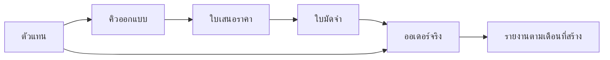

# ระบบตัวแทนร้าน BG SPORT

สถานะ: พัฒนาในโครงการแล้ว ต้องรัน migration ก่อนเปิดใช้งานจริง

## กติกาที่ผู้ใช้ยืนยัน

- บัญชีประเภท `agent` แยกจากแอดมินและพนักงาน
- ค่าคอมมิชชัน 2,500 กีบต่อเสื้อขาย ไม่รวมเสื้อแถมและกางเกง
- นับรายงานในเดือนที่สร้างออเดอร์จริง โดยใช้ `created_at` ตามเวลาลาว (UTC+7) ไม่ใช่วันที่บนเอกสารที่แก้ย้อนหลังได้
- ตัวแทนเห็นเฉพาะออเดอร์และเอกสารของตนเอง

```text
จำนวนเสื้อที่ได้คอมมิชชัน = short_qty + long_qty
ค่าคอมมิชชัน = จำนวนเสื้อขาย × อัตราที่บันทึกไว้กับออเดอร์
```

ตัวอย่าง: เสื้อแขนสั้น 80 ตัว แขนยาว 20 ตัว และแถม 5 ตัว ได้ 100 × 2,500 = 250,000 กีบ ไม่บวกรายละเอียดไซซ์ 3XL–6XL หรือรายการ `shirt_printed` ซ้ำกับจำนวนหัวออเดอร์

## วิธีใช้งาน

1. รัน `supabase/migrations/20261109_add_sales_agents.sql` แล้วตามด้วย `supabase/migrations/20261110_expand_agent_workflow_permissions.sql` ผ่าน Supabase SQL Editor หรือระบบ migration ของร้าน หากรันไฟล์แรกแล้ว ให้รันเฉพาะไฟล์ 20261110 เพื่อเพิ่มสิทธิ์สร้าง/แก้ใบมัดจำและลบคิวออกแบบ
2. Superadmin เปิดหน้าผู้ใช้และสร้างบัญชีประเภท “ຕົວແທນຮ້ານ (Agent)” ด้วยอีเมลและรหัสผ่าน ระบบตรวจ migration ก่อนสร้าง/เปลี่ยนเป็นบัญชีตัวแทน
3. ตัวแทนเข้าสู่ระบบและไปหน้า `/orders` อัตโนมัติ สร้างออเดอร์ได้ตามขั้นตอนเดิม
4. กด “ເບິ່ງຍອດຂາຍ ແລະ ຄ່າຄອມປະຈຳເດືອນ” ในหน้าออเดอร์ แล้วเลือกเดือน/ปี
5. Superadmin, Manager และ Accountant ดูภาพรวมและเลือกตัวแทนที่ `/reports/agent-sales` บัญชีที่ปิดใช้งานยังแสดงในตัวเลือกประวัติ

API keys ของแอปใช้รัน schema migration ไม่ได้ การตรวจสอบในงานนี้ใช้ฐานข้อมูลทดสอบแยก ยังไม่ได้รัน SQL กับฐานข้อมูลจริง

## สิทธิ์หน้าเว็บ

| งาน | URL จริง |
| --- | --- |
| รายการออเดอร์และรายงานส่วนตัว | `/orders` |
| สร้างออเดอร์ | `/orders/new` |
| แก้ไขออเดอร์ | `/orders/[id]/edit` |
| แจ้งเตือนออเดอร์ | `/order-alerts` |
| คิวออกแบบ | `/design-queue` |
| คิวออกแบบที่เสร็จแล้ว | `/design-queue/completed` |
| คลังรูปงานออกแบบ | `/design-queue/assets` |
| รายการใบเสนอราคา | `/quotations` |
| สร้างใบเสนอราคา | `/quotations/new` |
| แก้ไขใบเสนอราคา | `/quotations/new?draftId=...` |
| รายการมัดจำสั่งผลิต | `/factory-deposit-orders` |
| สร้างใบมัดจำสั่งผลิต | `/factory-deposit-orders/new` |
| แก้ไขใบมัดจำสั่งผลิต | `/factory-deposit-orders/new?id=...` |
| ออเดอร์รับเข้าจากโรงงาน | `/factory-receipts/orders` |
| จัดส่ง | `/shipments` |
| รายการใบฝากเครื่อง | `/shipments/notes` |

ใช้รายการอนุญาตแบบระบุหน้า รวมรูปแบบ URL แก้ออเดอร์จริง ไม่เปิดทุกหน้าลูกจาก prefix และ permission override ไม่สามารถขยายขอบเขตตัวแทนได้

ตัวแทนสร้างใบมัดจำโดยตรงหรือสร้างต่อจากใบเสนอราคา และแก้ใบมัดจำของตนในสถานะร่าง/ส่งแล้วได้ รวมถึงใบที่แอดมินสร้างให้โดยผูกตัวแทนไว้ ชื่อผู้สร้างเอกสารเดิมยังคงอยู่ ปุ่มบันทึกและส่งใช้ขั้นตอนผลิตอัตโนมัติเดิม การอนุมัติและแปลงเป็นออเดอร์ยังเป็นสิทธิ์ของฝ่ายร้าน และเอกสารที่อนุมัติ/แปลงแล้วรักษาข้อจำกัดการแก้ไขเดิม

ตัวแทนลบคิวออกแบบของตนได้ทั้งคิวรอออกแบบและคิวที่เสร็จแล้ว เมื่อลบคิว ระบบลบรายการรูปที่ผูกกับคิวและถอดลิงก์คิวจากเอกสารปลายทาง โดยเก็บใบเสนอราคา ใบมัดจำ ออเดอร์ และเจ้าของยอดเดิมไว้ การลบหรือแก้ข้อมูลของตัวแทนอื่นยังถูกปฏิเสธที่ฐานข้อมูล

## การผูกเจ้าของยอด



เพิ่ม `agent_user_id` ในคิว ใบเสนอราคา ใบมัดจำ และออเดอร์ เซิร์ฟเวอร์กำหนดจากบัญชีที่เข้าสู่ระบบและรับต่อจากเอกสารต้นทาง ไม่ใช้ `created_by_user_id` หรือ `admin_user_id` แทนเจ้าของยอด

- แอดมินสร้างใบมัดจำหรือแปลงเป็นออเดอร์ให้ ยังคงตัวแทนเดิม
- จุดแปลงออเดอร์ทั้งในหน้ารายการและหน้าฟอร์มส่ง `source_deposit_order_id` ป้องกันแปลงใบเดียวซ้ำด้วย unique index
- ออเดอร์ที่มีตัวแทนบันทึกอัตรา 2,500 และวันสร้างจริงที่ฐานข้อมูล การแก้วันที่บนเอกสารหรือส่งค่าอัตราจากไคลเอนต์ไม่เปลี่ยนสองค่านี้
- เจ้าของยอดเปลี่ยนผ่านการแก้เอกสารทั่วไปไม่ได้ การโอนงานแอดมินไม่เปลี่ยนตัวแทน
- ออเดอร์เดิมมีตัวแทนเป็น `null` ไม่เดาเจ้าของและไม่สร้างยอดย้อนหลัง
- บัญชีตัวแทนที่มีเอกสารอ้างอิงควรปิดใช้งานแทนการลบ เพื่อรักษาเจ้าของยอด

## ขอบเขตข้อมูล

บังคับ RLS ที่ตารางโดยใช้ restrictive policy ร่วมกับ policy เดิมที่บางตารางเปิด `using (true)` พร้อมตรวจการเขียนที่ trigger และตรวจ profile ที่ API:

- จำกัดออเดอร์ รายการสินค้า คิว ใบเสนอราคา ใบมัดจำ สลิป ประวัติ เอกสารจัดส่ง และรายการรับเข้าให้ตรงเจ้าของ
- ตารางธุรกิจอื่นที่มีอยู่ตอนรัน migration จะปฏิเสธตัวแทนเป็นค่าเริ่มต้น ส่วนตารางอ้างอิงที่แบบฟอร์มจำเป็นต้องใช้ยังอ่านได้
- บัญชีตัวแทนแก้ role ของตนหรืออนุมัติคำขอจัดส่งเองไม่ได้ บัญชีที่ปิดใช้งานอ่านและสร้างงานไม่ได้
- ใบฝากเครื่องที่แอดมินสร้างให้เห็นตามเจ้าของออเดอร์ ไม่อิงคนสร้างใบฝากเพียงอย่างเดียว
- รายการรับเข้าหลายตัวแทนใน batch เดียวอ่านผ่าน projection เฉพาะรายการของตน และไม่เปิดหมายเหตุรวมของ batch
- API รายงานกำหนดตัวแทนจาก profile ที่ตรวจสอบแล้ว ปฏิเสธการขอดู ID คนอื่น และไม่ส่งรายชื่อคนอื่นให้ตัวแทน
- badge ของตัวแทนใช้ JWT ของผู้เรียกและ RLS แทน query ด้วย service role
- Storage API จำกัดการแสดงรายการ อัปโหลด แทนที่ และลบไฟล์ให้อยู่ในงานของตน แม้ policy เดิมเปิดกว้าง

ระบบรูปและหน้าติดตามสาธารณะเดิมยังมี URL สำหรับแชร์ตามพฤติกรรมเดิม การจำกัดบัญชีนี้ไม่เปลี่ยน public bucket ให้เป็น private หากต้องการให้ไฟล์ที่เคยแชร์หมดอายุด้วย ต้องวางการย้าย Storage และ signed URL เป็นงานแยก

เมื่อเพิ่มตารางธุรกิจหรือ RPC ในอนาคต ต้องรวมขอบเขตตัวแทนในการออกแบบสิทธิ์ด้วย migration นี้ไม่สร้าง policy ให้อัตโนมัติแก่ตารางที่เพิ่มภายหลัง

## รายงานรุ่นนี้

รายงานมีจำนวนออเดอร์ เสื้อขาย เสื้อแถม ยอดขายสุทธิ และค่าคอมมิชชัน พร้อมรายละเอียดต่อออเดอร์ แสดง 20 แถวต่อหน้า ยอดรวมอ่านข้อมูลครบทุกหน้าจากฐานข้อมูล ไม่จำกัดที่ 1,000 รายการ

ยอดขายสุทธิเป็นยอดรวมออเดอร์ ซึ่งอาจมีกางเกงหรือค่าบวกเพิ่ม ค่าคอมมิชชันนับเฉพาะเสื้อขาย และไม่ต้องรอชำระครบหรือส่งสินค้า เนื่องจากเลือกนับเดือนที่สร้างออเดอร์

รายงานเป็นยอดปัจจุบัน การแก้จำนวนเสื้อจะปรับยอดในเดือนสร้างเดิม การลบออเดอร์โดยฝ่ายร้านจะนำรายการออกจากรายงาน ยังไม่มีการล็อกงวด บัญชีการจ่ายค่าคอมมิชชัน หรือ ledger ปรับยอดข้ามงวด จึงไม่แสดงยอดนี้ว่าเป็นเงินที่จ่ายแล้ว

## การตรวจสอบ

```bash
node --test tests/agent-sales.test.mjs tests/user-permissions.test.mjs tests/staff-access.test.mjs tests/shipment-approvals-auth.test.mjs
node scripts/verify-sales-agents.mjs /path/to/@electric-sql/pglite/dist/index.js
node scripts/verify-browser-sales-agents.mjs /path/to/playwright/index.mjs
npx tsc --noEmit --incremental false
npm run build
```

SQL verification ใช้ฐานข้อมูลแยก ตรวจการสร้าง/แก้/ส่งใบมัดจำ ไฟล์แนบ การลบคิวพร้อมเก็บเอกสารปลายทาง ตัวแทนสองคน การผูกเอกสาร การปลอมเจ้าของ/วัน/อัตรา การแปลงซ้ำ RLS เดิมที่เปิดกว้าง batch รับเข้าผสม การอนุมัติขนส่ง บัญชีปิดใช้งาน และการรัน migration ซ้ำ Browser verification ใช้ backend จำลอง ไม่มีการเขียนข้อมูลจริง
